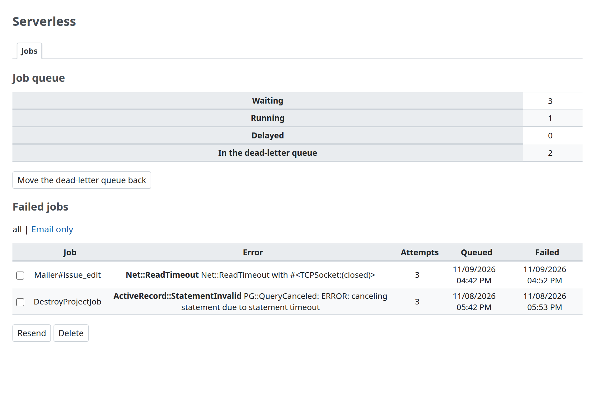

# Administration page

This is the administration page of Redmine AWS SQS. Only Redmine administrators can open it (`require_admin`). The page is the "Jobs" tab under the "AWS" item of Redmine's administration menu, which [Redmine AWS](https://redmine-kit.github.io/redmine_aws/admin.html#the-aws-menu) adds and all the Redmine AWS plugins share. The SQS check also joins the connection test on its "Status" tab.

| Item | Details |
| --- | --- |
| No secrets shown | AWS credentials, the message bodies of failed jobs and the messages of errors are not shown; errors are shown by their class, as on the "Status" tab of Redmine AWS. Queue counts are cached for 1 minute |
| Job arguments in the log | With the job queue on, a job's arguments are written to Redmine's log by the names of their parameters (the job's `perform`, or the mailer method for email), with Redmine's records as their IDs (GlobalID) and values cut at 50 characters. Rails' parameter filter (`config.filter_parameters`; Redmine filters `password`, `salt`, `twofa_totp_key` and `key`) replaces secrets with `[FILTERED]`, and `password` is filtered even without it: the account information email is logged as `Mailer#account_information(user: gid://redmine-app/User/2, password: [FILTERED])`. An argument without a known name is filtered unless it is a record or a number. This applies to ActiveJob's "Enqueued" and "Performing" lines, the failures the plugin records and failed resends. On Lambda, the line in which the gem's handler writes the whole event is written without it |
| Operations are logged | Resending, deleting and the DLQ redrive are written to Redmine's log with who did what (`[redmine_aws_sqs] <login> resent 1 of 1 job(s)`) |

## Jobs



| Item | Contents | Source |
| --- | --- | --- |
| Queue | Messages available, messages in flight, messages delayed (the terms of the SQS console; see "Terms" below) | SQS `GetQueueAttributes` (`ApproximateNumberOfMessages`, etc.) |
| Dead-letter queue | Number of jobs in the dead-letter queue | `GetQueueAttributes` of the dead-letter queue, found from the job queue's redrive policy |
| List of failed jobs | The job (for email, the mailer and the mail, such as `Mailer#issue_add`; failed email can be listed on its own), the error's class (its message is in Redmine's log), attempts, when it was enqueued and when it failed. The newest 100. The check box in the header row selects all rows, as in Redmine's issue list | The plugin's table (below) |
| Resend | Puts the selected jobs back on the job queue, and removes their records | `SendMessage` with the recorded message |
| Delete | Removes the selected records | — |
| Start DLQ redrive | Moves the jobs in the dead-letter queue back to the job queue. Shown when the dead-letter queue has jobs | SQS `StartMessageMoveTask` |
| Connection test | Whether SQS is reachable (on the "Status" tab of Redmine AWS) | SQS `GetQueueAttributes` |

| Item | Details |
| --- | --- |
| Recording failures | A job that raises is retried by SQS. The plugin records it on the receive after which SQS moves the message to the dead-letter queue (the `ApproximateReceiveCount` of the message reaches the `maxReceiveCount` of the job queue's redrive policy). It stores the message body (`job.serialize`), the error's class and the number of receives in its table (`aws_sqs_job_failures`), and the message still moves to the dead-letter queue, in case writing to the database fails. It also writes the job (its arguments filtered as above), the error's class and its message to Redmine's log (`[redmine_aws_sqs] job failed after 3 receive(s): …`); for a body that is not JSON, the class only, since the parser's message quotes the body. A message that can never run (not JSON, or a job class outside the allowed ones) is recorded at once and deleted, without retries. Without a redrive policy, SQS keeps a failing message until its retention period ends, and nothing is recorded |
| Where it is recorded | On Lambda, the plugin wraps the gem's handler (`Aws::ActiveJob::SQS::LambdaHandler.job_handler`, by `prepend`). With the gem's poller, it sets the gem's `poller_error_handler` and `permanent_failure_handler`, unless the application set its own |
| Resending | The recorded message body is sent to the job queue as it was, with the message attributes the adapter writes. Only a job of an allowed class is sent; the job runs again with the same job ID. The record and the dead-letter queue are separate: a resent job is usually still in the dead-letter queue too, so resend it from one place only (the DLQ redrive as well would run it twice). The record is locked and removed in the same transaction as the send, so resending it from two pages at once sends it once; a failed send keeps it |
| Settings in the worker | Redmine reloads its settings when an administrator changes them only at the start of a web request. While the job queue is on, every job does the same first (`Setting.check_cache`, a `before_perform` callback), on Lambda and with the gem's poller alike, so that a process that stays up sends email with the current settings |
| Resend flow | Fix the cause first (for example, resume SES sending, or remove an address from the suppression list), then resend. Which email errors are retried is decided by [Redmine AWS SES](https://redmine-kit.github.io/redmine_aws_ses/); resending email is described in [Serverless mail.md](https://redmine-kit.github.io/serverless/mail.html#when-sending-fails) |
| Keeping records | This task deletes the records of jobs that failed more than the given days ago (default 90; the command is below). Serverless runs it daily ([Serverless security.md](https://redmine-kit.github.io/serverless/security.html#retention-periods)) |

```sh
bin/rake redmine_aws_sqs:prune_records[<days>]
```

| Item | Details |
| --- | --- |
| Recipients | The list does not show the recipients of failed email. A mail job holds the user as a reference to the record, not the address |
| Contents of the records | A record keeps the message body, which holds the job's arguments as the adapter serialized them. Most arguments refer to Redmine's records by ID, but the account information email (`Mailer#account_information`, sent when an administrator saves a user with "Send account information to the user") holds the user's password. A body with an argument that the log filters (as above) is stored encrypted (`ActiveSupport::MessageEncryptor`, with a key derived from Redmine's `secret_key_base`), so the table holds no plaintext password, and resending decrypts it; changing `secret_key_base` makes such records impossible to resend. Redmine AWS SES records the email it drops in the same way. The page does not show the bodies. Delete the records that are no longer needed, and run the task above on a schedule outside Serverless as well |
| Without the job queue | Without `REDMINE_JOBS_QUEUE_URL`, the page says that Redmine runs jobs as standard, shows the records that are left, and cannot resend |

## Permissions

The role of web requests gets permissions to read the queue counts, to resend jobs and to start the DLQ redrive. The list and an example policy are in [iam.md](iam.md).

## Tests

Functional tests for the page, on SDK response stubs ([Serverless testing.md](https://redmine-kit.github.io/serverless/testing.html#administration-pages)).

The screenshot on this page is taken with `bin/screenshots` (headless Chromium in Docker, with Redmine's test data and example queue counts). Run it after changing the page.

<a id="terms"></a>

## Terms

The screen uses the Japanese terms of the AWS console and documentation for SQS (checked on 2026-11-10).

| Screen (en / ja) | AWS term | Source | Status |
| --- | --- | --- | --- |
| Messages available / 利用可能なメッセージ | `ApproximateNumberOfMessagesVisible` | The SQS console's queue list, as quoted in a third-party article (https://dev.classmethod.jp/articles/tsnote-sqs-console-poll-messages-dlq-receive-count/); the documentation describes it as 「取得および処理が可能なメッセージ」 (https://docs.aws.amazon.com/ja_jp/AWSSimpleQueueService/latest/SQSDeveloperGuide/sqs-available-cloudwatch-metrics.html) | To recheck in the console |
| Messages in flight / 処理中のメッセージ | `ApproximateNumberOfMessagesNotVisible` | Same article; the documentation writes 「処理中メッセージ」 | To recheck in the console |
| Messages delayed / 遅延メッセージ | `ApproximateNumberOfMessagesDelayed` | https://docs.aws.amazon.com/ja_jp/AWSSimpleQueueService/latest/SQSDeveloperGuide/sqs-available-cloudwatch-metrics.html | Documentation |
| Start DLQ redrive / DLQ 再処理を開始 | `StartMessageMoveTask` | The console button 「DLQ 再処理の開始」 in https://docs.aws.amazon.com/ja_jp/AWSSimpleQueueService/latest/SQSDeveloperGuide/sqs-configure-dead-letter-queue-redrive.html | Documentation |
