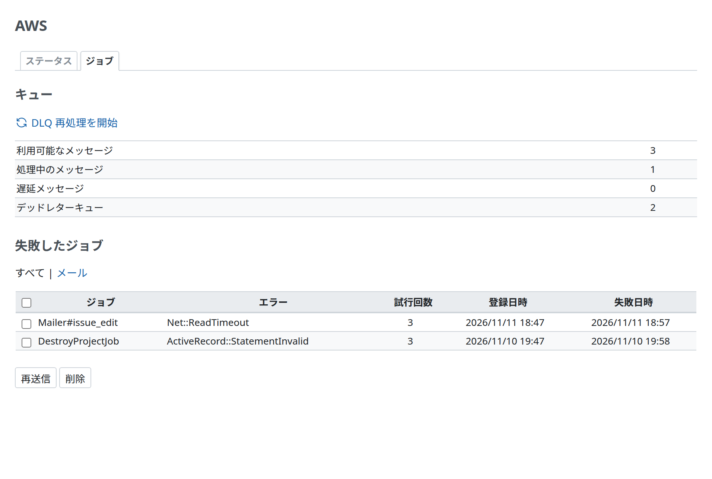

# 管理画面

Redmine AWS SQS の管理画面です。開けるのは Redmine の管理者だけです (`require_admin`)。画面は、[Redmine AWS](https://redmine-kit.github.io/redmine_aws/ja/admin.html#the-aws-menu) が追加し、すべての Redmine AWS のプラグインが共有する Redmine の管理メニューの「AWS」の下の、「ジョブ」のタブになります。SQS の確認は、その「ステータス」のタブの接続テストにも加わります。

| 項目 | 内容 |
| --- | --- |
| 秘密を出さない | AWS の認証情報と、失敗したジョブのメッセージの本文は出しません。キューの件数は 1 分キャッシュします |
| ログのジョブの引数 | ジョブキューを使うとき、ジョブの引数は、パラメーター名 (ジョブの `perform`、メールならメーラーのメソッド) とともに Redmine のログに書きます。Redmine のレコードは ID (GlobalID) で書き、値は 50 文字で切ります。秘密の値は、Rails のパラメーターフィルター (`config.filter_parameters`。Redmine は `password`、`salt`、`twofa_totp_key`、`key` を指定) が `[FILTERED]` に置き換えます。`password` は、その指定がなくても置き換えます。アカウント情報のメールは `Mailer#account_information(user: gid://redmine-app/User/2, password: [FILTERED])` と書きます。名前がわからない引数は、レコードと数値のほかは置き換えます。対象は、ActiveJob の「Enqueued」と「Performing」の行、プラグインが記録する失敗、失敗した再送信です。Lambda では、gem のハンドラーがイベント全体を書く行を、イベントなしで書きます |
| 操作を記録する | 再送信、削除、DLQ 再処理は、誰が何をしたかを、Redmine のログに書きます (`[redmine_aws_sqs] <ログイン> resent 1 of 1 job(s)`) |

<a id="jobs"></a>

## ジョブ



| 項目 | 内容 | 出どころ |
| --- | --- | --- |
| キュー | 利用可能なメッセージ、処理中のメッセージ、遅延メッセージ (SQS のコンソールの語。下の「用語」) | SQS の `GetQueueAttributes` (`ApproximateNumberOfMessages` など) |
| デッドレターキュー | デッドレターキューにあるジョブの数 | デッドレターキューの `GetQueueAttributes`。デッドレターキューは、ジョブキューの再処理ポリシーから知る |
| 失敗したジョブの一覧 | ジョブ (メールなら、`Mailer#issue_add` のようなメーラーとメール。失敗したメールだけを並べることもできる)、エラーのクラスとメッセージ、試行回数、登録日時と失敗日時。新しい 100 件。見出し行のチェックボックスで、Redmine のチケットの一覧と同じく全行を選べる | プラグインのテーブル (下記) |
| 再送信 | 選んだジョブをジョブキューに戻し、その記録を消す | 記録したメッセージでの `SendMessage` |
| 削除 | 選んだ記録を消す | — |
| DLQ 再処理を開始 | デッドレターキューのジョブを、ジョブキューに戻す。デッドレターキューにジョブがあるときに出す | SQS の `StartMessageMoveTask` |
| 接続テスト | SQS に届くか (Redmine AWS の「ステータス」のタブで) | SQS の `GetQueueAttributes` |

| 項目 | 内容 |
| --- | --- |
| 失敗の記録 | 例外を発生させたジョブは、SQS が再試行します。プラグインは、SQS がメッセージをデッドレターキューに移す前の最後の受信 (メッセージの `ApproximateReceiveCount` が、ジョブキューの再処理ポリシーの `maxReceiveCount` に届いたとき) で記録します。メッセージの本文 (`job.serialize`)、エラー、受信回数を、プラグインのテーブル (`aws_sqs_job_failures`) に保存し、ジョブ (引数は上のとおりに置き換え)、エラーのクラスとメッセージを Redmine のログに書きます (`[redmine_aws_sqs] job failed after 3 receive(s): …`。JSON でない本文では、パーサーのメッセージが本文を引用するため、クラスだけ)。データベースへの書き込みが失敗したときに備えて、メッセージはそのままデッドレターキューに移ります。決して実行できないメッセージ (JSON でないもの、実行してよいクラスにないもの) は、すぐに記録して消し、再試行しません。再処理ポリシーがなければ、SQS は失敗するメッセージを保持期間が終わるまで残し、何も記録しません |
| 記録する場所 | Lambda では、プラグインが gem のハンドラー (`Aws::ActiveJob::SQS::LambdaHandler.job_handler`) を `prepend` でラップします。gem のポーラーでは、gem の `poller_error_handler` と `permanent_failure_handler` を設定します。アプリケーションが自分で設定していれば、それを使います |
| 再送信 | 記録したメッセージの本文を、アダプターが書くメッセージ属性といっしょに、そのままジョブキューに送ります。送るのは、実行してよいクラスのジョブだけです。ジョブは同じジョブ ID でもう一度動きます。記録とデッドレターキューは別々です。再送信したジョブは、たいていデッドレターキューにも残っているので、再送信するのはどちらか一方からにします (DLQ 再処理もすると、2 回動きます) |
| 再送信の流れ | 先に原因を直してから (SES の送信を再開する、サプレッションリストからアドレスを外す、など)、再送信します。どのメールのエラーを再試行するかは [Redmine AWS SES](https://redmine-kit.github.io/redmine_aws_ses/ja/) が決めます。メールの再送信は [Serverless の mail.md](https://redmine-kit.github.io/serverless/ja/mail.html#when-sending-fails) にあります |
| 記録の保持 | 次のタスクが、指定した日数より前に失敗したジョブの記録を消します (デフォルトは 90 日。コマンドは下記)。Serverless は毎日動かします ([Serverless の security.md](https://redmine-kit.github.io/serverless/ja/security.html#retention-periods)) |

```sh
bin/rake redmine_aws_sqs:prune_records[<日数>]
```

| 項目 | 内容 |
| --- | --- |
| 宛先 | 一覧には、失敗したメールの宛先を出しません。メールのジョブは、ユーザーをアドレスではなく、レコードへの参照として持つからです |
| 記録の内容 | 記録はメッセージの本文を持ち、本文には、アダプターがシリアライズしたジョブの引数があります。引数の多くは Redmine のレコードを ID で指しますが、アカウント情報のメール (`Mailer#account_information`。管理者が「アカウント情報をユーザーに送信」にチェックしてユーザーを保存したときに送る) は、ユーザーのパスワードを平文で持ちます。画面には本文を出しません。要らなくなった記録は削除し、Serverless の外でも上のタスクをスケジュールで実行します |
| ジョブキューがないとき | `REDMINE_JOBS_QUEUE_URL` がなければ、画面は、Redmine が標準のとおりにジョブを動かすことを示し、残っている記録を出します。再送信はできません |

<a id="permissions"></a>

## 権限

Web リクエストを処理するロールに、キューの件数を読み、ジョブを再送信、DLQ 再処理を開始する権限を与えます。一覧と例のポリシーは [iam.md](iam.md) にあります。

<a id="tests"></a>

## テスト

画面の機能テストです。SDK の応答のスタブで動かします ([Serverless の testing.md](https://redmine-kit.github.io/serverless/ja/testing.html#administration-pages))。

このページの画面のスクリーンショットは、`bin/screenshots` で撮ります (Docker の中のヘッドレス Chromium と、Redmine のテストデータ、キューの件数の例を使います)。画面を変えたら実行します。

<a id="terms"></a>

## 用語

画面の語は、SQS のコンソールとドキュメントの日本語に合わせています (2026-11-10 に確認)。

| 画面 (ja / en) | AWS の語 | 出典 | 状態 |
| --- | --- | --- | --- |
| 利用可能なメッセージ / Messages available | `ApproximateNumberOfMessagesVisible` | 第三者の記事が引く SQS のコンソールのキューの一覧 (https://dev.classmethod.jp/articles/tsnote-sqs-console-poll-messages-dlq-receive-count/)。ドキュメントの説明は「取得および処理が可能なメッセージ」(https://docs.aws.amazon.com/ja_jp/AWSSimpleQueueService/latest/SQSDeveloperGuide/sqs-available-cloudwatch-metrics.html) | コンソールで要確認 |
| 処理中のメッセージ / Messages in flight | `ApproximateNumberOfMessagesNotVisible` | 同じ記事。ドキュメントは「処理中メッセージ」 | コンソールで要確認 |
| 遅延メッセージ / Messages delayed | `ApproximateNumberOfMessagesDelayed` | https://docs.aws.amazon.com/ja_jp/AWSSimpleQueueService/latest/SQSDeveloperGuide/sqs-available-cloudwatch-metrics.html | ドキュメント |
| DLQ 再処理を開始 / Start DLQ redrive | `StartMessageMoveTask` | コンソールのボタン「DLQ 再処理の開始」(https://docs.aws.amazon.com/ja_jp/AWSSimpleQueueService/latest/SQSDeveloperGuide/sqs-configure-dead-letter-queue-redrive.html) | ドキュメント |
